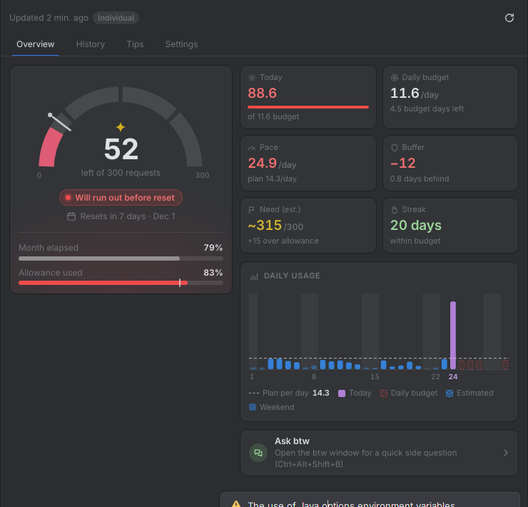
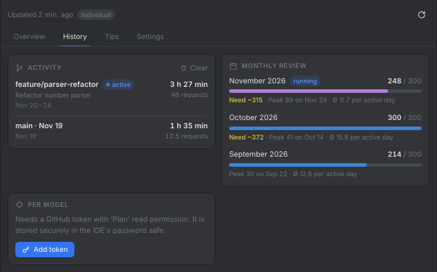
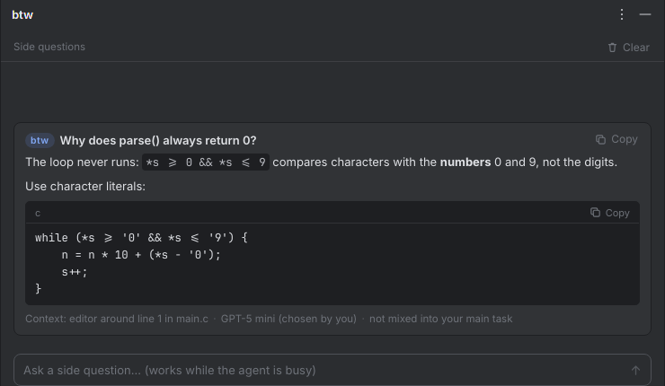
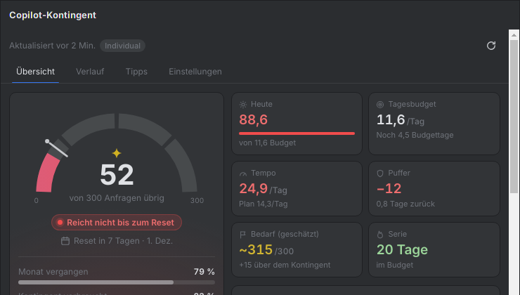

# Copilot Contingent Watcher für CLion

CLion-Plugin (läuft in allen JetBrains-IDEs ab 2025.2), das dein GitHub-Copilot-Kontingent (Premium-Anfragen oder AI Credits) in der Statusleiste anzeigt, ein Tagesbudget berechnet und rechtzeitig warnt.

Es ist die JetBrains-Version der VS-Code-Erweiterung [Copilot Contingent Watcher](https://github.com/m3-13/vsc-contingent-watcher) und hat denselben Funktionsumfang. Rechenlogik, Tipps, Texte und die Dashboard-Oberfläche sind direkt übernommen.



## Was es macht

- Zeigt verbleibendes Kontingent, Verbrauch, Prozent oder Tagesbudget in der **Statusleiste**. Das Icon zeigt den Füllstand. Bei hohem Tempo bekommt der Eintrag einen gelben oder roten Hintergrund.
- **Dashboard** (Klick auf die Statusleiste oder das Toolwindow *Copilot Contingent* rechts) mit 4 Tabs:
  - **Übersicht:** Tachometer, Heute, Tagesbudget, Tempo, Puffer, Bedarf, Serie, Tagesdiagramm und ein Hinweis gegen Verfall
  - **Verlauf:** woran du gearbeitet hast und wie lange (aktive Zeit pro Git-Branch, mit Verbrauch), Monatsrückblick, Verbrauch pro Modell
  - **Tipps:** Spartipps passend zur aktuellen Lage
  - **Einstellungen:** Anzeige, Warnungen, Budget, Akzentfarbe, Statusleisten-Icon und -Farbe, Copilot-Schalter, btw, Konto
- **btw – Nebenfrage wie in Claude Code:** `Strg+Alt+Umschalt+B` (macOS: `Cmd+Alt+Shift+B`) öffnet das **btw-Fenster** mit eigenem Eingabefeld. Fragen werden sofort beantwortet, auch während der Copilot-Agent arbeitet, und nicht mit deiner Hauptaufgabe vermischt. Im Editor-Kontextmenü gibt es zusätzlich **btw: Auswahl erklären**. Die Antwort kennt deinen Editor (Auswahl oder Code um den Cursor, mit Fehlern und Warnungen) und nutzt das Chat-Modell, ein einmal gewähltes Modell oder ein Gratis-Modell.
- **Credits statt Requests:** Meldet GitHub AI-Credits (nutzungsbasierte Abrechnung), zeigt das Plugin Credits an. Einstellbar unter *Anzeige › Zeigen*.
- **Bedarf (geschätzt):** wie viel dein Monat bei deinem Tempo gebraucht hätte, auch wenn das Kontingent schon leer ist.
- **Hinweis gegen Verfall:** In der letzten Monatswoche meldet das Plugin, wenn ein Teil des Kontingents voraussichtlich ungenutzt verfällt.
- Berechnet ein **Tagesbudget** bis zum Reset (optional ohne Wochenenden, mit Reserve) und prognostiziert, an welchem Tag das Kontingent bei gleichem Tempo leer wäre.
- **Warnt** bei Schwellenwerten (z. B. 50/75/90/100 %) und bei zu hohem Tempo, jeweils höchstens einmal.
- Gibt Spartipps und bringt einen **Erste-Schritte-Dialog** mit.
- Deutsch und Englisch: folgt der Sprache der IDE oder ist fest einstellbar.

| Verlauf | btw-Fenster | Deutsch |
| --- | --- | --- |
|  |  |  |

## Installation

1. Plugin bauen (siehe *Entwicklung*) oder die ZIP aus den CI-Artefakten nehmen.
2. In CLion: *Settings › Plugins › ⚙ › Install Plugin from Disk…* und `clion-contingent-watcher-<version>.zip` wählen.
3. Nach dem Neustart erscheint das Kontingent unten rechts in der Statusleiste.

Voraussetzung ist CLion (oder eine andere JetBrains-IDE) ab **2025.2**. Für Dashboard und btw-Fenster braucht die IDE den eingebetteten Browser (JCEF). Er ist in den offiziellen Builds enthalten.

## Wie es funktioniert

- **Anmeldung ohne eigenes Login:** Das Plugin nutzt die vorhandene Anmeldung des **GitHub-Copilot-Plugins**. Alternativ nimmt es ein **GitHub-Konto aus den IDE-Einstellungen** (*Versionskontrolle › GitHub*) oder einen Token, den du selbst eingibst. Ein eingegebener Token liegt im Passwortspeicher der IDE. Sonst speichert das Plugin keinen Token.
- Liest den undokumentierten Endpunkt `api.github.com/copilot_internal/user`.
- **btw** fragt Copilots Chat-Modelle mit der Anmeldung des Copilot-Plugins, also über dein eigenes Copilot-Abo.
- Alle Daten bleiben lokal. Es gibt keine Telemetrie und keinen weiteren Server.

## Einstellungen

Alle Einstellungen findest du unter *Settings › Tools › Copilot Contingent Watcher* und im Dashboard-Tab *Einstellungen*. Beide sind dieselben Werte.

| Einstellung | Standard | Beschreibung |
| --- | --- | --- |
| Anmeldeanbieter | Automatisch | `Automatisch`, `GitHub.com` oder `Enterprise` (GHE.com / Enterprise Server). |
| Enterprise-Adresse | leer | z. B. `https://firma.ghe.com` oder `https://github.firma.com`. Wird bei Automatisch auch aus dem Copilot-Plugin oder den IDE-Konten erkannt. |
| Token von | Automatisch | Copilot-Plugin, GitHub-Konto der IDE oder selbst eingegebener Token. |
| API-URL (erweitert) | leer | Optionale API-Basis-URL, z. B. `https://api.firma.ghe.com`. |
| Aktualisieren alle | 10 Min. | Aktualisierungsintervall (2 bis 120 Minuten). Wird die IDE aktiv, wird ebenfalls aktualisiert. |
| Statusleiste zeigt | Verbleibend | `Verbleibend`, `Verbraucht`, `Prozent` oder `Pro Tag`. |
| Statusleisten-Icon | Tachometer | `Tachometer`, `Batterie`, `Ring`, `Balken`, `Keins`. |
| Statusleisten-Farbe | auto | Vorlage (`teal`, `violet`, `blue`, `green`, `orange`, `pink`) oder `#hex`. |
| Zeigen | Auto | `Auto` (Credits, wenn vorhanden), `Credits` oder `Anfragen`. |
| Sprache | Wie die IDE | `Wie die IDE`, `English` oder `Deutsch`. |
| Akzentfarbe | auto | Farbe des Tachometers und der Diagramme. |
| Spartipp im Tooltip | an | Zeigt einen passenden Tipp im Tooltip der Statusleiste. |
| Wochenenden zählen | aus | Wochenenden als Budgettage zählen. |
| Reserve | 0 | Reserve, die nicht ins Tagesbudget eingeht. |
| Schwellenwert-Warnungen | an | Benachrichtigungen ein/aus. |
| Warnen bei | 50, 75, 90, 100 | Prozentwerte, bei denen gewarnt wird. |
| Tempo-Warnung | an | Warnung, wenn das Kontingent vor dem Reset leer wäre. |
| Restkontingent-Hinweis | an | Hinweis, wenn Kontingent ungenutzt verfallen würde. |
| Aktivität aufzeichnen | an | Aktive Zeit und Verbrauch pro Git-Branch aufzeichnen (nur lokal). |
| btw: Modell | Chat-Modell | `Chat-Modell` (das Modell deines Chats, falls erkennbar, sonst einmal gewählt) oder `Gratis-Modell`. |
| btw: Gratis-Modelle | `gpt-5-mini, gpt-4.1, gpt-4o` | Inklusive Modelle für den Modus `Gratis-Modell`, in dieser Reihenfolge. |
| btw öffnen in | Angedockt | `Angedockt neben dem Editor` oder `Eigenem Fenster`. |
| Aktuellen Chat in btw einbeziehen | an | Eine lokale Chat-Sitzung als Kontext nutzen (siehe Hinweise). |
| Ordner mit Chat-Sitzungen | leer | Optionaler Ordner mit Chat-Sitzungen (JSON/JSONL). |

## Aktionen

Alle Aktionen stehen unter *Tools › Copilot Contingent* und in *Find Action* (`Strg+Umschalt+A`, Suche nach „Copilot Contingent“).

| Aktion | Beschreibung |
| --- | --- |
| Kontingent-Details anzeigen | Öffnet das Dashboard. |
| Kontingent aktualisieren | Daten sofort neu laden. |
| Spartipps anzeigen | Öffnet den Tab *Tipps*. |
| btw: Nebenfrage stellen | Öffnet das btw-Fenster mit Fokus im Eingabefeld (`Strg+Alt+Umschalt+B`). |
| btw-Fenster anzeigen | Zeigt das btw-Fenster, ohne den Fokus zu wechseln. |
| btw: Auswahl erklären | Im Editor-Kontextmenü: erklärt die markierte Stelle im btw-Fenster. |
| Mit GitHub anmelden | Geführte Anmeldung (Kontotyp, Enterprise-Adresse, Anmeldequelle). |
| Warnungen für 24 Stunden stummschalten | Snooze. |
| Verbrauch pro Modell einrichten | Token für die Billing-API hinterlegen. |
| Einstellungen öffnen | Öffnet die Einstellungsseite. |
| Log anzeigen | Zeigt, welcher Anbieter und welche URL genutzt wurden und welchen HTTP-Status die Abfrage hatte. Tokens werden nie geloggt. |
| Erste Schritte | Kurzer Einstieg mit Direktlinks. |

## Verbrauch pro Modell (optional)

Das zeigt, welches Modell wie viel deines Kontingents verbraucht. Dafür braucht es einen *fine-grained* GitHub-Token mit der Account-Berechtigung **Plan (read)**. Du richtest ihn im Dashboard unter *Verlauf* oder über *Verbrauch pro Modell einrichten* ein. Der Token liegt im Passwortspeicher der IDE.

## Enterprise-Accounts & Fehlersuche

- **Copilot Business/Enterprise auf github.com:** Hier ist nichts einzustellen.
- **GHE.com (`firma.ghe.com`) oder GitHub Enterprise Server:** *Mit GitHub anmelden* ausführen und die Adresse eingeben. Ist das Copilot-Plugin bereits mit dem Enterprise-Konto angemeldet, erkennt das Plugin die Adresse automatisch.
- **403 / SSO:** Deine Organisation verlangt evtl. eine SAML-SSO-Freigabe, oder sie blockiert den Endpunkt.
- **Log:** Über *Log anzeigen* siehst du, welcher Anbieter, welche Anmeldequelle und welche URL genutzt wurden und welchen HTTP-Status die Abfrage hatte.

## Unterschiede zur VS-Code-Version

Die Funktionen sind dieselben. Wo JetBrains-IDEs anders funktionieren, wurde das so gelöst:

| VS Code | CLion |
| --- | --- |
| Anmeldung über die GitHub-Anmeldung von VS Code | Anmeldung des GitHub-Copilot-Plugins, GitHub-Konto der IDE oder eigener Token |
| Dashboard als Webview in der Activity Bar | Toolwindow *Copilot Contingent* mit derselben Oberfläche (JCEF), Farben aus dem IDE-Theme |
| `@btw` direkt im Copilot-Chat | Das Copilot-Plugin für JetBrains bietet keine Schnittstelle für eigene Chat-Teilnehmer. Deshalb: btw-Fenster mit Kürzel `Strg+Alt+Umschalt+B` und Kontextmenü *btw: Auswahl erklären* |
| btw nutzt die Language-Model-API von VS Code | btw nutzt Copilots Modell-API mit der Anmeldung des Copilot-Plugins |
| Chat-Kontext aus den Chat-Sitzungen von VS Code | Best effort: Chat-Sitzungen im JSON/JSONL-Format aus dem Ordner des Copilot-Plugins oder einem selbst gewählten Ordner. Das JetBrains-Copilot-Plugin speichert seine Chats in einem eigenen Format; findet das Plugin keine lesbare Sitzung, nutzt btw nur den Editor-Kontext. |
| Copilot-Schalter aus Copilots Einstellungen | Copilots eigene Aktionen werden zur Laufzeit gesucht (Vorschläge an/aus, pro Sprache, Snooze, Chat öffnen). Was die installierte Copilot-Version nicht anbietet, wird ausgeblendet. Die Eagerness-Einstellung gibt es dort nicht. |
| Statusleiste links oder rechts | Die IDE legt die Position fest. Ein- und ausblenden geht per Rechtsklick auf die Statusleiste. |
| Walkthrough | Erste-Schritte-Dialog |
| Output-Channel „Copilot Contingent“ | *Log anzeigen* öffnet das Log in einem Editor-Tab |

## Spartipps

Seit Mitte 2026 rechnen viele Pläne Copilot nutzungsbasiert ab, in AI-Credits nach Tokens. Der größte Kostentreiber ist deshalb die Kontextgröße.

- **Neuer Chat pro Aufgabe:** Lange Verläufe werden bei jeder Anfrage mitgeschickt.
- **Gezielter Kontext:** Häng einzelne Dateien oder die Auswahl an statt der ganzen Codebasis, und füge aus Logs nur die relevanten Zeilen ein.
- **Weniger Tools:** Aktiviere nur die Tools und MCP-Server, die die Aufgabe braucht.
- **Passendes Modell:** Nimm das günstigste Modell, das reicht, oder *Auto*. Starke Reasoning-Modelle sind für schwere Probleme da.
- **Instructions und Prompt-Dateien:** Projektregeln gehören in `.github/copilot-instructions.md`, wiederkehrende Aufgaben in Prompt-Dateien.
- **Kostenlos:** Inline-Vorschläge und Next Edit Suggestions verbrauchen kein Kontingent.

Im Dashboard zeigt der Tab *Tipps* immer nur die Tipps, die gerade zu deiner Lage passen. Es sind rund 40, je nach Status, Zeitpunkt im Monat und drohendem Verfall.

## Entwicklung

Voraussetzung: JDK 21. Gradle wird über den Wrapper geladen.

```bash
./gradlew test               # Unit-Tests der Rechenlogik, Parser und btw-Bausteine
./gradlew buildPlugin        # erzeugt build/distributions/clion-contingent-watcher-<version>.zip
./gradlew runIde             # startet CLion mit dem Plugin
./gradlew runIdeForUiTests   # startet IntelliJ IDEA Community 2025.2 (ohne Lizenzdialog)
./gradlew verifyPlugin       # prüft die Kompatibilität mit CLion 2025.2 und 2026.3
```

Aufbau:

| Ordner | Inhalt |
| --- | --- |
| `src/main/kotlin/.../core` | Reine Rechenlogik (Port von `src/core` der VS-Code-Erweiterung): Parser, Prognose, Metriken, Zyklen, Tipps |
| `src/main/kotlin/.../btw` | btw: Prompt, Modellwahl, Chat-Sitzungs-Parser, Copilot-Modell-API, Ablauf |
| `src/main/kotlin/.../services` | Einstellungen, lokaler Speicher, Anmeldung, Abruf, Warnungen, Aktivität |
| `src/main/kotlin/.../ui` | Statusleiste, Dashboard- und btw-Toolwindow (JCEF), Einstellungsseite, Dialoge |
| `src/main/kotlin/.../integration` | Optionale Anbindung an das GitHub-Plugin und Git der IDE |
| `src/main/resources/web` | Dashboard- und btw-Oberfläche (aus der VS-Code-Erweiterung übernommen) |
| `src/main/resources/l10n` | Deutsche Übersetzungen (Bundle der VS-Code-Erweiterung plus CLion-Texte) |

## Hinweise

- Die Endpunkte `copilot_internal/user` und Copilots Modell-API sind **nicht dokumentiert** und können sich jederzeit ändern oder wegfallen.
- GitHub hat 2026 für viele Pläne auf nutzungsbasierte AI Credits umgestellt. Das Plugin ist einheitenunabhängig und zeigt je nach Plan Anfragen oder Credits.
- Kein offizielles GitHub- oder JetBrains-Produkt.

## Lizenz

MIT, siehe [LICENSE](LICENSE).
